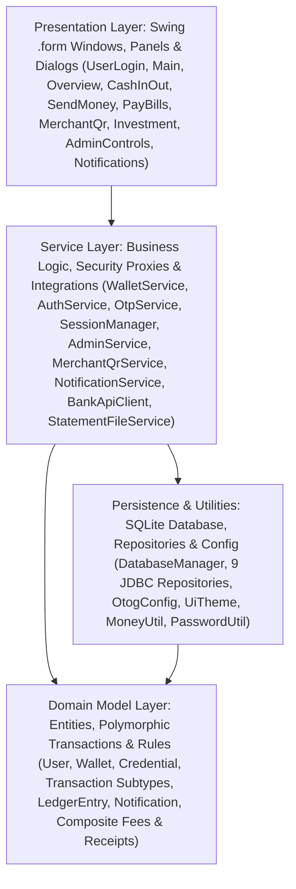

# One Team One Goal (OTOG) — E-Wallet System

An **E-Wallet Desktop Application** built in **Java (Swing + SQLite)** that lets users manage digital wallets, deposit and withdraw funds, send money to other users, pay bills, pay merchants via QR codes, trade simulated investments, view filtered history and receipts, receive transaction notifications, export/import wallet statements, and govern accounts through role-based admin controls.

Developed in compliance with **CSIT227 — Object-Oriented Programming**.

---

## Getting Started

### Prerequisites
- **JDK 19 or higher** (tested on OpenJDK 21 and 25 LTS)

### Running in IntelliJ IDEA
1. Open the `OTOG` folder in IntelliJ IDEA.
2. Ensure the project SDK is set to **JDK 19+** and the JARs in `lib/` are loaded.
3. Run `src/UserLogin.java` (`UserLogin.main`).

### Running from the Command Line
*(On Windows, replace `:` with `;` inside `-cp`.)*

```bash
# 1. Compile all source and test files
mkdir -p out/production/OTOG
find src test -name '*.java' > sources.txt
javac -encoding UTF-8 -cp "lib/*" -d out/production/OTOG @sources.txt && rm -f sources.txt
cp config/otog.properties out/production/OTOG/otog.properties

# 2. Run the automated JUnit 5 test suite
java --enable-native-access=ALL-UNNAMED \
  -jar lib/junit-platform-console-standalone-1.10.2.jar execute \
  -cp "out/production/OTOG:lib/sqlite-jdbc-3.47.0.0.jar:lib/forms_rt.jar" \
  --scan-classpath

# 3. Launch the application
java --enable-native-access=ALL-UNNAMED -cp "out/production/OTOG:lib/*" UserLogin
```

### Default Demo Accounts
On first launch, the database (`data/otog.db`) automatically seeds four deterministic demo accounts and three linked bank accounts (**BDO**, **BPI**, and **Metrobank**) per seeded user, configured in [`config/otog.properties`](config/otog.properties):

| Role | Name / Username | Mobile | Password | Transaction PIN | Starting Balance |
| :--- | :--- | :--- | :--- | :--- | :--- |
| `ADMIN` | `admin` | `09000000000` | `password` | `123456` | `PHP 1,000.00` |
| `MERCHANT` | `OTOG Merchant Store` | `09178888888` | `Merchant123!` | `8888` | `PHP 0.00` |
| `USER` | `Demo Sender` | `09000000101` | `DemoPass123!` | `1234` | `PHP 5,000.00` |
| `USER` | `Demo Recipient` | `09000000102` | `DemoPass123!` | `5678` | `PHP 1,500.00` |

> **2FA OTP Code:** Printed to the terminal/console as `[SIMULATED SMS] OTP for ...` and displayed in the simulated SMS prompt on the login screen.

New standard user accounts can also be created directly from the login screen via **Register** (each new account automatically receives a `PHP 0.00` wallet and demo bank links).

---

## Features

### Account Security & Authentication
- **Registration & Salted Passwords**: Normalizes Philippine mobile numbers (`+639...` or `9...` → `09XXXXXXXXX`), enforces unique mobile numbers, and hashes passwords using a random 16-byte salt with SHA-256 (`PasswordUtil`). Accounts lock after **5** failed login attempts.
- **Two-Factor Authentication (2FA OTP)**: Issues an account-bound 6-digit OTP (`OtpService`) with a 5-minute expiration, one-time use, 5-attempt limit, and 60-second resend cooldown.
- **Transaction PIN & Session Timeout**: Outgoing payments require a hashed 4–6 digit PIN (locks after 3 failed attempts; can be set, changed, or reset with password verification). Sessions automatically expire after **15 minutes** of inactivity (`SessionManager`).

### Wallet & Financial Integrity
- **Exact Currency Math**: Uses `BigDecimal` (`MoneyUtil`) with Philippine Peso (`PHP`), 2 decimal places, and Banker's rounding (`HALF_EVEN`), rejecting zero, negative, or fractional-cent amounts.
- **Atomic Transactions & Ledger**: Every balance change, transaction record, and double-entry ledger entry (`DEBIT`/`CREDIT` with `balance_before` and `balance_after`) commits together or rolls back completely on failure.
- **Duplicate & Double-Spend Protection**: Enforces unique transaction reference numbers (`UNIQUE(reference_number)`) and acquires per-wallet locks in a consistent order to prevent concurrent double-spending.

### Cash-In & Cash-Out
- Supports deposits and withdrawals across linked demo banks and channels (**GCash**, **Maya**, **BDO**, **BPI**, **7-Eleven OTC**).
- Uses a simulated Bank API (`BankApiClient` / `MockBankAdapter`) with configurable outcomes (`SUCCESS`, `REJECTED`, `FAILED`, `TIMEOUT`, `PENDING`, `UNKNOWN`). Failed withdrawals automatically release reserved funds back to the wallet, while pending operations can be checked via status lookup.

### Send Money (Peer-to-Peer Transfers)
- Resolves recipients by mobile number, username, email, user ID, or wallet ID (`SendMoneyService`).
- Enforces configurable transfer limits (`PHP 1.00` – `PHP 50,000.00`), checks available balance including fees, and shows a confirmation preview dialog before asking for the Transaction PIN.

### Transaction History, Receipts & Notifications
- **Filtered History**: Filter personal transaction history by date range, transaction type, status, or keyword (`TransactionFilter`).
- **Masked Receipts & Repeat Draft**: View privacy-masked transaction receipts (`ReceiptBuilder`) and clone any previous transaction into a fresh pre-filled draft with one click (**Repeat Draft**).
- **Notification Inbox**: Stores post-commit transaction alerts in SQLite with duplicate prevention (`dedup_key`), displays a live unread badge on the dashboard, and isolates failed notification saves in a FIFO retry queue so retries never repeat payments.

### File Handling (Store & Load Statements)
- Export and reload masked wallet statements in both **pipe-delimited text (`.txt`)** and **CSV (`.csv`)** formats, as well as individual transaction receipts (`StatementFileService`).
- Uses `BufferedWriter` and `BufferedReader` with `try-with-resources`, validates file headers and numeric precision on load, and connects to `JFileChooser` in the dashboard **Overview** tab.

### Admin Controls & Audit Trail
- **Role-Based Access (`USER`, `MERCHANT`, `ADMIN`)**: Only administrators can view all accounts/wallets, change roles, or suspend/reactivate users; self-registration as `ADMIN` and self-suspension are blocked.
- **Suspension & Accountability**: Suspending an account requires a written reason, freezes the user's wallet, invalidates active sessions, and blocks outgoing payments. Every admin action is logged in `admin_actions` with sensitive values (passwords, PINs, salts, tokens) automatically redacted.
- **No Direct Balance Editing**: Arbitrary balance edits are explicitly prohibited (`UnsupportedOperationException`); all balance changes must occur through ledger-backed transactions.

### Merchant QR Payments
- **Seeded Merchant Demo Account**: Automatically seeds `OTOG Merchant Store` (`USR-MERCHANT-01` / `WLT-MERCHANT-01`, mobile `09178888888`, password `Merchant123!`, PIN `8888`, role `MERCHANT`) alongside the default administrator and demo user accounts.
- **Role-Gated Merchant Terminal & Sales**: Accounts with `MERCHANT` or `ADMIN` role can generate fixed-amount or open-amount project QR PNGs (`MerchantQrPanel`), export them off the EDT, and inspect received QR payments with merchant-perspective receipts. Standard `USER` accounts see only the **Pay Merchant (QR Import)** flow.
- **Validated Pre-PIN Confirmation & Atomic Settlement**: Importing a QR validates the checksum, merchant account & wallet status, currency, customer account & wallet currency, self-payment rules, and duplicate single-use reference (`REQ-QR-<ref>`), renders DB-verified merchant details and a confirmation preview (`MerchantPaymentPreview`), and settles atomically via `WalletOperations.transferWithPin`.
- **Documented Project QR Format (`OTOG-MERCHANT-QR-v1` + `OTOGQR` PNG Raster)**:
  - **Wire Grammar** (UTF-8, max `8192` bytes):
    ```text
    OTOG-MERCHANT-QR-v1|mid=<merchantId>|mwid=<merchantWalletId>|name=<escapedName>|amt=<positiveDecimalOrEmpty>|curr=<ISO4217>|ref=<uniqueRef>|note=<escapedNote>|crc=<HEX_CRC32>
    ```
    Delimiter/control characters (`%`, `|`, `=`, `\r`, `\n`) inside `name` and `note` are percent-escaped (`%25`, `%7C`, `%3D`, `%0D`, `%0A`). Unknown keys, duplicate keys, missing required fields (`mid`, `mwid`, `name`, `curr`, `ref`), and amounts with scale > 2 are rejected. `crc` is the uppercase hex IEEE CRC-32 computed over the exact raw canonical segment between `OTOG-MERCHANT-QR-v1|` and `|crc=`.
  - **PNG Raster Encoding (`OTOGQR`)**: The UTF-8 payload is embedded losslessly into the bottom pixel rows of the `300x300` PNG starting at `(0, height - 1)` moving left-to-right and bottom-to-top (one byte per grayscale pixel, `R = G = B = byte`):
    ```text
    [6B ASCII "OTOGQR"][4B big-endian length N][N bytes UTF-8 payload][4B big-endian IEEE CRC-32]
    ```
    Import verifies image pixel capacity and CRC-32 integrity before decoding.

### Pay Bills
- Supports 5 seeded utility billers (**Meralco**, **Manila Water**, **Maynilad**, **PLDT**, **Globe Telecom**) via `BillPaymentTransaction`, `PayBillsPanel`, and `WalletService.payBill*`.
- Provides live fee/total calculation, biller reference validation and receipt masking, PIN authorization, atomic fund reservation/release, and post-commit notifications.

### Simulated Investments
- Supports buying and redeeming units in the seeded simulated fund (`OTOG-SIM-FUND` — *OTOG Simulated Balanced Fund*) via `InvestMoneyTransaction`, `InvestmentPanel`, and `InvestmentService`.
- Includes pre-trade buy/redeem previews, persistent per-wallet holdings tracking (`investment_holdings`), and Transaction PIN authorization.

### Simulated Loans (CAP-12)
- **Single Configured Simulated Product**: `OTOG-SIM-LOAN` — *OTOG Simulated Quick Cash Loan* (`PHP 500.00` – `PHP 10,000.00`, `3.00%` monthly flat interest, `3`-month term, processing fee `PHP 25.00 + 1.00%` via `CompositeFeePolicy.forLoan()`), configured in [`config/otog.properties`](config/otog.properties) and persisted in `loan_products` and `loans`.
- **Documented Interest & Fee Calculation**:
  - `interest = round_HALF_EVEN_2(principal × monthlyInterestRate × termMonths)`
  - `processingFee = flatFee + round_HALF_EVEN_2(principal × percentFee)`
  - `totalRepaymentDue = principal + interest + processingFee` (single full lump-sum repayment)
- **Lifecycle & Safety Guards**: Users preview total repayment and apply in the bound Swing panel (`LoanPanel.form`); administrators approve (single atomic disbursement crediting the wallet exactly once with audit log) or reject (with mandatory reason and zero disbursement) in the role-gated **Admin Loan Approvals** sub-tab; borrowers view `Amount Due` and execute atomic full repayment with Transaction PIN authorization. Duplicate disbursement, partial repayment, insufficient-funds repayment, and repeat repayment of a paid loan are rejected.
- **Explicitly Deferred Scope**: Installment scheduling, partial repayment, late penalties, and advanced eligibility scoring remain explicitly deferred.

---

## System Architecture & Class Diagram

The codebase follows a four-layer architecture where the UI communicates only through service interfaces, keeping business rules, security checks, and SQLite persistence cleanly separated:



### Domain Class Diagram

Original UML class diagram ([`Class Diagram/ewallet_cd.png`](Class%20Diagram/ewallet_cd.png)):


### Project Structure

```text
OTOG/
├── Class Diagram/
│   └── ewallet_cd.png            # UML class diagram
├── config/
│   └── otog.properties           # Externalized runtime settings & deterministic demo seeds
├── docs/
│   └── CAP-14-FEATURE-FREEZE.md  # Integration checkpoint, demo catalog & feature freeze policy
├── lib/                          # SQLite JDBC, JUnit 5, IntelliJ forms_rt
├── src/
│   ├── UserLogin.java / .form    # Application entry point (Login, 2FA & CLI --verify/--seed-demo/--reset-demo)
│   └── com/otog/
│       ├── database/             # SQLite connection & ACID transaction helper
│       ├── exception/            # Custom domain exceptions
│       ├── model/                # Entities, transaction subtypes, QR payload, fees, receipts & enums
│       ├── repository/           # SQLite JDBC data access classes
│       ├── service/              # Core services, proxies, adapters, QR, demo seeder & file I/O
│       ├── ui/                   # Bound IntelliJ Swing .form dashboard & dialogs
│       └── util/                 # Config, theme, currency, password & ID helpers
└── test/com/otog/                # JUnit 5 unit & cross-feature integration test suites
```

---

## OOP Concepts & Design Patterns

### Core OOP Principles
- **Encapsulation**: Domain entities protect balances, credentials, and statuses behind validated methods (`MoneyUtil`, `Wallet.debit`/`credit`, `AdminAction.sanitizeDetails`).
- **Abstraction**: Swing screens depend only on service interfaces (`WalletOperations`, `AuthService`, `AdminService`, `LoanService`, `InvestmentService`) rather than concrete implementations.
- **Inheritance**: `Transaction` is extended by `CashInOutTransaction`, `SendMoneyTransaction`, `BillPaymentTransaction`, `LoanTransaction`, and `InvestMoneyTransaction`; domain errors extend `OtogException`.
- **Polymorphism**: `TransactionRepository` restores exact `Transaction` subclasses from SQLite via `TransactionFactory.createEmptyForType(...)`, and each subclass customizes receipt formatting (`appendSubtypeReceiptLines`) and draft cloning (`copyAsDraft`).

### GoF Design Patterns Applied (12 Patterns)

| Type | Pattern | Where Used | Purpose |
| :--- | :--- | :--- | :--- |
| **Creational** | **Singleton** | `SessionManager`, `OtogConfig` | Maintains one shared user session and one loaded configuration instance across the app. |
| **Creational** | **Factory Method** | `TransactionFactory` | Creates the right `Transaction` subclass cleanly for both new operations and database reads. |
| **Creational** | **Abstract Factory** | `PaymentProviderFactory` | Builds matching mock bank adapters, API clients, and fee policies for each test/gateway mode. |
| **Creational** | **Builder** | `TransactionBuilder`, `ReceiptBuilder`, `TransactionFilter.Builder` | Assembles validated transactions, aligned receipts, and history filters step by step. |
| **Creational** | **Prototype** | `TransactionPrototype` + `Transaction` subclasses | Clones a past transaction into a new `PENDING` draft without altering the original record. |
| **Structural** | **Adapter** | `BankAdapter`, `MockBankAdapter`, `BankApiClient` | Wraps external payment/bank channels behind a single uniform interface. |
| **Structural** | **Bridge** | `ExportableDocument` ↔ `DocumentFormat` (`PipeTextDocumentFormat`, `CsvDocumentFormat`) | Separates what is exported (statements or receipts) from the file format (`.txt` or `.csv`). |
| **Structural** | **Composite** | `ReceiptComponent` (`ReceiptLine`, `ReceiptSection`), `FeeComponent` (`FlatFee`, `PercentageFee`, `CompositeFeePolicy`) | Combines simple and nested receipt sections or fee rules through one unified interface. |
| **Structural** | **Decorator** | `BankAdapterDecorator`, `ValidatingBankAdapterDecorator`, `AuditingBankAdapterDecorator` | Dynamically adds input validation and secret-free call auditing around `BankAdapter`. |
| **Structural** | **Facade** | `WalletService`, `AdminServiceImpl` | Hides locking, SQLite transactions, ledger writes, and permission checks behind simple service methods. |
| **Structural** | **Flyweight** | `UiTheme` | Reuses shared `Font`, `Color`, and `Border` objects across all Swing screens instead of recreating them. |
| **Structural** | **Proxy (Protection)** | `ProtectedWalletOperationsProxy`, `ProtectedAdminServiceProxy` | Verifies active sessions, wallet ownership, and `ADMIN` permissions before forwarding service calls. |

---

## User Interface (Swing `.form` Screens)

Every window, tab panel, and modal dialog is built with a bound **IntelliJ IDEA GUI Designer `.form` file** using `GridLayoutManager` (`lib/forms_rt.jar`). All heavy work (database, hashing, file I/O) runs off the Swing UI thread via `SwingWorker`, with validation and errors displayed cleanly via `JOptionPane`.

| Screen / Form | Class | What It Does |
| :--- | :--- | :--- |
| `src/UserLogin.form` | `UserLogin` | Password sign-in, simulated SMS 2FA verification (with Resend & Back), and Register button |
| `src/com/otog/ui/RegisterDialog.form` | `RegisterDialog` | New account registration with password check and automatic wallet creation |
| `src/com/otog/ui/PinSettingsDialog.form` | `PinSettingsDialog` | Set, change, or reset the 4–6 digit Transaction PIN |
| `src/com/otog/ui/Main.form` | `Main` | Main dashboard shell with user balance, Back-navigation history, Notifications badge, and tabs |
| `src/com/otog/ui/OverviewPanel.form` | `OverviewPanel` | Quick Actions, statement export/import, history filters, receipt viewer, and Repeat Draft |
| `src/com/otog/ui/CashInOutPanel.form` | `CashInOutPanel` | Cash-In / Cash-Out form with bank/channel selection, mock gateway mode, and PIN entry |
| `src/com/otog/ui/SendMoneyPanel.form` | `SendMoneyPanel` | Wallet-to-wallet transfer form with recipient preview confirmation and PIN entry |
| `src/com/otog/ui/AdminControlsPanel.form` | `AdminControlsPanel` | Admin-only panel for managing users/wallets, suspending/reactivating accounts, and viewing audit logs |
| `src/com/otog/ui/NotificationInboxDialog.form` | `NotificationInboxDialog` | Modal inbox for reading, filtering unread, and marking notifications as read |
| `src/com/otog/ui/PayBillsPanel.form` | `PayBillsPanel` | Bill payment form with 5 utility billers, live fee/total preview, reference validation, and PIN entry |
| `src/com/otog/ui/MerchantQrPanel.form` | `MerchantQrPanel` | Merchant QR import/pay confirmation flow and role-gated Merchant Terminal & Sales view |
| `src/com/otog/ui/LoanPanel.form` | `LoanPanel` | Simulated single-product loan repayment preview, application, full repayment, and role-gated Admin Loan Approvals |
| `src/com/otog/ui/InvestmentPanel.form` | `InvestmentPanel` | Simulated investment buy/redeem preview, holdings summary, and activity table |

---

## Database & Configuration

### SQLite Database Schema (`data/otog.db`)
Managed automatically on startup by `DatabaseManager` with foreign keys enabled (`PRAGMA foreign_keys = ON`):

| Table | Stores |
| :--- | :--- |
| `users` | User profiles, unique mobile numbers, roles (`USER`, `MERCHANT`, `ADMIN`), and account status |
| `wallets` | Each user's wallet balance (`BigDecimal` text), currency (`PHP`), and status (`ACTIVE`, `FROZEN`, `CLOSED`) |
| `credentials` | Salted SHA-256 password and PIN hashes, failed attempt counts, and lockout timestamps |
| `payment_methods` | Linked bank accounts, e-wallets, and cards per user |
| `transactions` | Full transaction records, unique reference numbers, amounts, fees, types, statuses, and provider details |
| `ledger_entries` | Double-entry `DEBIT` and `CREDIT` rows recording balances before and after every movement of funds |
| `investment_products` | Seeded simulated investment product catalog and simulated unit prices |
| `investment_holdings` | Per-wallet simulated investment unit holdings and total invested principal |
| `admin_actions` | Traceable log of administrative actions with reasons and secret-redacted details |
| `notifications` | Post-commit user alerts with read status and unique deduplication keys |

### Runtime Configuration (`config/otog.properties`) & Demo CLI
All key settings — database path, transfer limits (`PHP 1.00` – `PHP 50,000.00`), default fees, OTP expiry/cooldown, lockout thresholds, session timeout (15 min), payment channels, demo accounts, window dimensions, and UI colors — are stored in [`config/otog.properties`](config/otog.properties) and loaded by `OtogConfig`. Any value can be overridden at launch using `-Dotog.<key>=<value>`.

```bash
# Verify deterministic demo data & print summary
java --enable-native-access=ALL-UNNAMED -cp "out/production/OTOG:lib/*" UserLogin --seed-demo

# Reset data/otog.db to a fresh deterministic demo baseline
java --enable-native-access=ALL-UNNAMED -cp "out/production/OTOG:lib/*" UserLogin --reset-demo
```

See [CAP-14 Feature Freeze & Demo Guide](docs/CAP-14-FEATURE-FREEZE.md) for the frozen scope matrix, deferred modules, and deterministic demo credentials.

---

## Automated Testing

The repository includes **19 JUnit 5 test suites** covering core domain rules, security, concurrency, design patterns, file I/O, Pay Bills, Merchant QR, Simulated Investments, UI behavior, and cross-feature integration (`IntegrationCheckpointTest`).

---

## Team Members

| Member | Role |
| :--- | :--- |
| **Marc Andrei Regulacion** | Baseline & Domain Owner |
| **Jeremy Navarro** | Auth, Login UI & Bill Payments |
| **Kyle Nino Duran** | Core Transactions UI |
| **Matthew Dela Cruz** | Admin Controls, Loans & Investments |
| **Al Francis Egtic** | Security, QA & Docs |
